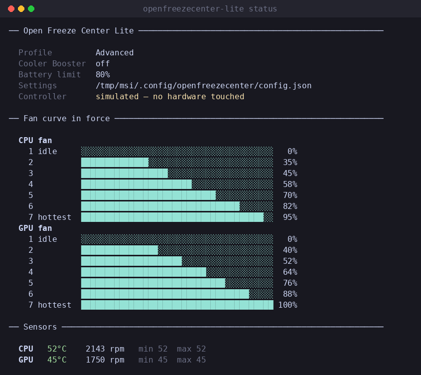
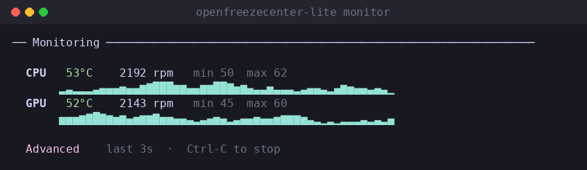
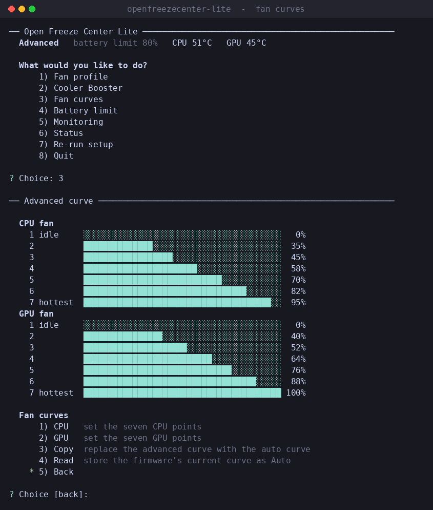

# OpenFreezeCenter-Lite (OFC-l)

Fan profiles, temperature monitoring and battery charge limiting for MSI
laptops on Linux, from the terminal. Everything
[OpenFreezeCenter](https://github.com/YoCodingMonster/OpenFreezeCenter) does,
without the window.

- **Fan profiles** — Auto, Basic (the auto curve shifted by an offset) and
  Advanced (your own curve), plus Cooler Booster as an independent toggle.
- **Fan curve editor** — set all seven CPU and seven GPU points, from the menu
  or in one command.
- **Live monitoring** — CPU and GPU temperature, fan RPM, minimum, maximum and
  a rolling 60 second graph drawn in text.
- **Battery charge limit** — stop charging between 50% and 100%.
- **An interactive menu** when you want one, and a plain command for every
  action when you would rather script it.

The two programs share `~/.config/openfreezecenter/config.json`, so a machine
with both installed has one set of fan curves, not two.

## Screenshots

`openfreezecenter-lite status` — what is set, the curve in force, and the
sensors right now:



`openfreezecenter-lite monitor` — temperatures, fan RPM, the extremes and a
rolling graph, redrawn in place:



Run it with no command and it opens a menu, with the fan curve editor behind
option 3:



## Requirements

- Python 3.5 or newer — no PyGObject, no GTK, no `pip`, no virtual environment
- A kernel with the `ec_sys` module (every mainstream kernel has it)
- Secure Boot disabled, so the module can be loaded
- `sudo`

That is the whole list, which is the point: the GUI needs GTK 4.14 and so
rules out Ubuntu 22.04, Debian 12, RHEL 9 and anything older. This runs on all
of them, and on current releases just as well. It is equally at home over SSH,
on a serial console, or in a terminal with no colour and no Unicode — the
display drops back to ASCII on its own, or with `--ascii` if you want to force
it.

Version 6 no longer needs the `ECTweaker` package: it talks to the embedded
controller through debugfs directly. Nothing is installed from the internet.

## Installation

Download and unpack the release, then, **as your normal user**:

```bash
chmod +x install.sh
```

```bash
./install.sh
```

It enables EC read/write, installs the program in `/opt/openfreezecenter-lite`
and puts `openfreezecenter-lite` (short form `ofc-lite`) on your path. Re-run
it any time to update. If the EC could not be enabled without a reboot the
script says so — disable Secure Boot, reboot, then start the program.

To remove everything it installed:

```bash
./install.sh --uninstall
```

You can also just run it out of the folder, with no installation at all:

```bash
sudo ./OpenFreezeCenter-Lite.py
```

## Running

With no command it opens a menu:

```bash
openfreezecenter-lite
```

It asks for your password through `sudo`, because reading and writing the
embedded controller needs root. The first run asks two questions — which side
of Intel's 11th generation your processor is on, and where the auto fan curve
should come from — and remembers the answers.

To look around on any machine, with no MSI hardware involved:

```bash
openfreezecenter-lite --simulate
```

## Commands

Every menu action is also a command, so fan control can go in a script, a
keyboard shortcut or a cron job.

| Command | What it does |
|---|---|
| `status` | settings, the curve in force, and a sensor reading |
| `monitor` | live temperatures and fan speeds until Ctrl-C |
| `profile [auto\|basic\|advanced]` | select a profile; no argument shows the current one |
| `profile basic --offset 10` | Basic is the auto curve shifted by this much |
| `booster [on\|off\|toggle]` | Cooler Booster, on top of whichever profile is set |
| `curve --cpu 0,40,48,56,64,72,80` | set the seven advanced CPU points (`--gpu` likewise) |
| `curve --copy-from-auto` | start the advanced curve from the auto one |
| `curve --read-from-ec` | store the curve the firmware is holding as Auto |
| `battery 80` | stop charging at 80% |
| `apply` | write the saved settings to the EC again |
| `setup` | re-run the first-run questions |
| `config [show\|path]` | print the settings, or where they live |

Useful flags: `--simulate`, `--ascii`, `--no-colour`, and for `monitor`
`--interval`, `--count`, `--plain` and `--json`. They work before or after the
command name. `status --json` and `monitor --json` print machine-readable
output on stdout and nothing else, so both pipe cleanly:

```bash
openfreezecenter-lite monitor --json -i 5 | tee temperatures.jsonl
```

## Keeping a profile across reboots

The EC forgets the profile when the machine powers off. On a systemd system
the installer leaves a unit that writes it back at boot; it does nothing until
you turn it on:

```bash
sudo systemctl enable openfreezecenter-lite.service
```

## Settings

Settings live in `~/.config/openfreezecenter/config.json`, owned by you rather
than root. A `config.py` from an older version is migrated automatically on
first run and left behind as `config.py.migrated`.

The `hardware` section holds the EC register addresses. Only touch it if you
are porting a model that is not listed below — and please open a pull request
if you get one working.

## Upgrading from version 5 or earlier

- Your old `config.py` is imported automatically; nothing to do by hand.
- **Cooler Booster is now a toggle, not a fourth profile.** It layers on top
  of whichever profile is selected, so you can leave Advanced set and still
  boost.
- **Basic now means "the auto curve plus an offset"**, which is what the old
  config comment described. The previous build applied the offset to an
  all-zero curve instead, so Basic drove the fans to roughly the offset value
  at every temperature — near-silent, and much hotter than intended.
- **`ECTweaker` is no longer used**, so the virtual environment is gone. Once
  you are happy, delete the old `OFC-l` folder and its `bin/`, `lib/` and
  `pyvenv.cfg`.
- The program no longer reboots your machine to enable EC access; `install.sh`
  loads the module there and then.

## Supported laptop models (tested)

- MSI GP76 11UG

## Supported Linux distributions (tested)

- Ubuntu

## Issue format

`ISSUE # [CPU] - [LAPTOP MODEL] - [LINUX DISTRO]`

Example: `ISSUE # i7-11800H - MSI GP76 11UG - UBUNTU 24.04`

## Feedback

Please put suggestions under the Feedback discussion tab.

## Goals

- [X] Fan control
- [X] Temperature and RPM monitoring
- [X] Advanced and Basic control without hand-editing a file
- [X] Battery threshold

## AI had been used to do proper documentations, script commenting and assisted in the UI layouts too!
